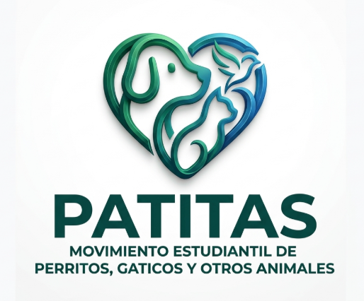

# 3. Nombre del proyecto y detalles



## Gestor de PQRS - Patitas 

Sistema de gestión de Peticiones, Quejas, Reclamos y Sugerencias (PQRS) para servicios veterinarios de perros y gatos y otros animales, desarrollado para el curso de Algoritmia y Programación - Universidad de Antioquia.

## 1. Integrantes del equipo

- **Duvan Estiben Granado Alzate** — duvan.granado@udea.edu.co — Ingeniería Industrial
- **Mario Estrada** — mario.estrada2@udea.edu.co — Ingeniería Industrial
- **Samuel González Contreras** — samuel.gonzalez4@udea.edu.co — Ingeniería Industrial
- **Yeison Solar** — y.solar@udea.edu.co — Ingeniería Industrial

## Descripción del proyecto

Programa de consola en Python que permite registrar, consultar y actualizar 
Peticiones, Quejas, Reclamos y Sugerencias (PQRS) relacionadas con la atención 
de perros y gatos, generando radicados y estadísticas de gestión.

## 2. Vínculos académicos y descripción

Todos los integrantes pertenecen al programa de **Ingeniería Industrial**. A continuación, las fortalezas y habilidades de cada uno en el equipo:

* **Duvan Granado Alzate**
* *Fortalezas:* Capacidad analítica para la optimización de procesos lógicos, estructuración de requerimientos técnicos, disposición constante para el trabajo en equipo y manejo en la distribución responsable del tiempo en las metas del proyecto, responsabilidad y paciencia en el desarrollo de los proyectos.
  
* **Mario Estrada**
  * *Fortalezas:* Capacidades en la organización de datos, manejo eficiente de herramientas ofimáticas como Excel, disposición y atención para la solución de problemas algorítmicos y un gran sentido de compañerismo que facilita la integración del grupo junto con la responsabilidad y compromiso con las actividades.
    
* **Samuel González Contreras**
  * *Fortalezas:* Excelente trabajo colaborativo en equipo, diseño de la estructura del código base en Python y enfoque ordenado en el uso responsable del tiempo, capacidades de resolución de problemas dentro y fuera del trabajo junto con la responsabilidad y el trabajo en equipo presente.  

* **Yeison Solar**
  * *Fortalezas:* Rigurosidad en el control de calidad, enfoque en la documentación de los procesos, soporte en la validación de requerimientos y concentración para prestar las mejores soluciones al equipo. 

---
## Estructura del repositorio

- `src/` — Código fuente en Python
- `docs/` — Documentación, plan de proyecto, actas y [manual de usuario](docs/manual_de_usuario.md)
- `images/` — Logo y diagramas de Gantt del proyecto
- `data/` — Archivos planos (Peticion.txt, Queja.txt, Reclamo.txt, Sugerencia.txt, Usuarios.txt)

## Cómo ejecutar el programa

Requisitos: **Python 3.8 o superior**. No hay que instalar librerías adicionales.

1. Descargue o clone el repositorio:
   ```
   git clone https://github.com/duvangranado-code/patitas-pqrs.git
   ```
2. Abra una terminal en la carpeta del proyecto y entre a `src`:
   ```
   cd patitas-pqrs/src
   ```
3. Ejecute el programa:
   ```
   python main.py
   ```
   (en algunos computadores el comando es `python3 main.py`).

También puede abrir `src/main.py` en Visual Studio Code y pulsar el botón de ejecutar.
El programa pide usuario y clave; los usuarios de prueba están en `data/Usuarios.txt`.
La guía completa de uso está en el [manual de usuario](docs/manual_de_usuario.md).

## Qué hace el sistema

- **Login** con máximo 3 intentos y bloqueo temporal.
- **Registrar PQRS** (petición, queja, reclamo o sugerencia) con validación de todos los datos.
- **Consultar PQRS** por tipo e ID, mostrada como radicado de 120 caracteres.
- **Registrar cambio de estado** (Registrada → En proceso → Solucionada).
- **Estadísticas**: promedio de días de respuesta, distribución por mascota, canal y campus, efectividad por estado y alerta de vencimiento.
- **Exportar** un resumen en texto y un archivo consolidado para el tablero de Power BI.

Plazo de respuesta definido por el equipo: **15 días calendario**.

## Módulos de `src/`

| Archivo | Función |
|---|---|
| `main.py` | Programa principal y menú. |
| `autenticacion.py` | Inicio de sesión y control de intentos. |
| `pqrs.py` | Registrar, consultar y cambiar el estado de las PQRS. |
| `validaciones.py` | Validación de nombre, documento, teléfono, correo, fechas y demás datos. |
| `archivos.py` | Lectura y escritura de los archivos planos de `data/`. |
| `radicado.py` | Comprobante de radicado en texto ASCII (120 caracteres de ancho). |
| `reportes.py` | Estadísticas y exportación de resultados. |

